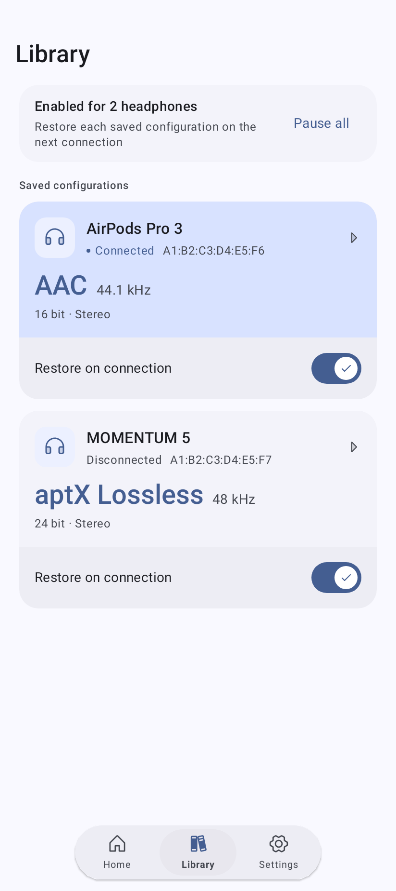

# Codecobo

**English** | [Español](docs/i18n/README_ES.md) | [日本語](docs/i18n/README_JA.md) | [Português](docs/i18n/README_PT.md) | [简体中文](docs/i18n/README_ZH_HANS.md) | [繁體中文](docs/i18n/README_ZH_HANT.md)

> Adjust Bluetooth audio settings on Android, save per-device configurations, and restore them on reconnect.

[](https://github.com/myuverr/codecobo/actions/workflows/android.yml) [](#usage) [](LICENSE)

Codecobo is an open-source Bluetooth codec manager for A2DP headphones and speakers. Devices can be associated through Android's system interface or silently through Shizuku's privileged service.

<p align="center">
  
  
</p>

## Features

- View the current codec, sample rate, bit depth, channel mode, and LDAC quality settings.
- Adjust audio settings and see the resulting device output.
- Save configurations for different devices and restore them on reconnect.
- Turn restoration on or off per device, or pause it for all devices.
- Check the current audio status through a persistent notification.

## Download

[](https://github.com/myuverr/codecobo/releases/latest)

## Usage

Requires Android 13 or later. No root access needed.

1. Connect your headphones or speaker in Android's Bluetooth settings.
2. Open Codecobo, grant the "Nearby devices" permission, and select the device you want to adjust.
3. Choose a codec and audio settings, then tap **Save**. Complete the device association prompt if it appears on first use.
4. Enable automatic restoration for the device if wanted. Manage saved configurations in **Library**.

The persistent status notification can be enabled separately in **Settings**.

## Build from source

Build a Debug version for development and debugging:

```sh
./gradlew assembleDebug
```

Build a Release APK:

```sh
./gradlew assembleRelease
```

## License

Licensed under the [MPL-2.0](LICENSE).
