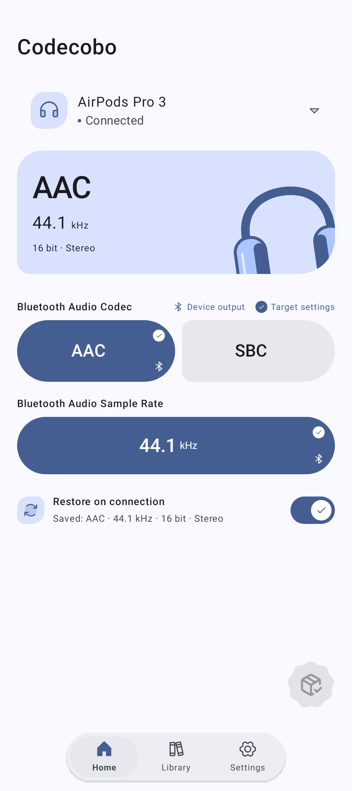

# Codecobo

[English](../../README.md) | [Español](README_ES.md) | **日本語** | [Português](README_PT.md) | [简体中文](README_ZH_HANS.md) | [繁體中文](README_ZH_HANT.md)

> Android の Bluetooth オーディオ設定を調整し、デバイスごとに保存して再接続時に自動復元。

[](https://github.com/myuverr/codecobo/actions/workflows/ci.yml) [](#使い方) [](../../LICENSE)

Codecobo は、A2DP 対応のヘッドホンやスピーカー向けのオープンソースの Bluetooth コーデック管理アプリです。Android のシステム画面からのデバイス関連付けに加え、Shizuku の特権サービスによるサイレントな関連付けにも対応しています。

<p align="center">
  
  
</p>

## 機能

- 現在のコーデック、サンプルレート、ビット深度、チャンネルモード、LDAC の音質設定を確認。
- オーディオ設定を変更し、デバイスに反映された結果を確認。
- デバイスごとに設定を保存し、再接続時に自動で復元。
- デバイスごとに自動復元をオン・オフ。すべての復元の一時停止にも対応。
- 常駐通知で現在のオーディオ状態を確認。

## ダウンロード

[](https://github.com/myuverr/codecobo/releases/latest)

## 使い方

Android 13 以降に対応。root 権限は不要です。

1. Android の Bluetooth 設定でヘッドホンやスピーカーを接続します。
2. Codecobo を開き、「付近のデバイス」へのアクセスを許可して、設定するデバイスを選びます。
3. コーデックとオーディオ設定を選び、**保存**をタップします。初回にデバイスの関連付けを求められた場合は、画面の案内に従います。
4. 再接続時に設定を復元したい場合は、そのデバイスの自動復元を有効にします。保存した設定は**ライブラリ**で管理できます。

常駐の状態通知は、**設定**から個別に有効にできます。

## ソースからビルド

開発やデバッグ用の Debug 版をビルド：

```sh
./gradlew assembleDebug
```

Release APK をビルド：

```sh
./gradlew assembleRelease
```

## ライセンス

[MPL-2.0](../../LICENSE) ライセンスで公開しています。
